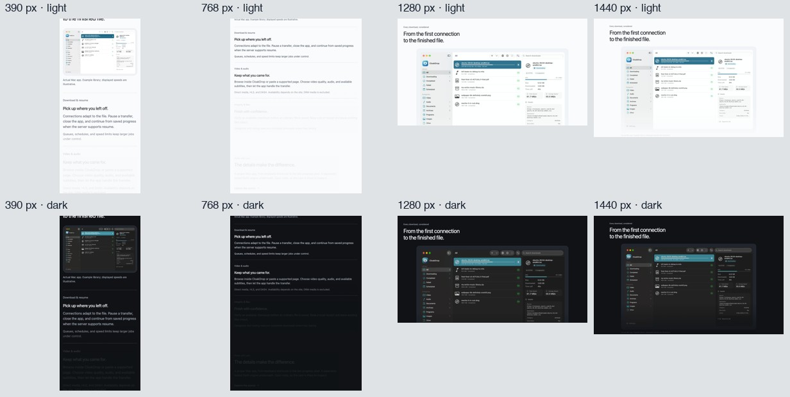

# CloakDrop landing motion and web dependencies

24 November 2026 · Air 1.8.1

Product introduction and preview, feature and principle articles and download instructions.

The production landing passed 22 viewport sizes in both themes in Chromium and
WebKit. The browser measured the combined 520 ms wipe, fade and 4 px settle,
checked the stagger where blocks enter together, and scrolled back through the
page to check that blocks play once. Focus, initial fragments, return from
privacy, live reduced motion, print, forced colours and the missing-observer
fallback passed. A touch profile also checked direct navigation with reduced motion.

## Dependencies and feature coverage

Compared all 5 direct web runtime and development package declarations with
the npm registry and refreshed the lockfile. Astro 7.4.13, Sitemap 3.7.6, Wrangler 4.167.0 and npm 12.2.3. TypeScript 6.0.3 is the latest supported by Astro Check 0.9.12.

Clean npm installation, package-tree check, audit, Astro diagnostics, site build, metadata validation, Knip and Wrangler Worker dry-run. Link checks covered 356 layouts and states and 130 keyboard checks across home, privacy and recovery. Navigation correctly marks the last section when it reaches the bottom of the page.

This review covered the web landing and the listed regression checks on local
builds. Physical-device and assistive-technology acceptance remain open.

## Release verification

The website includes the Air 1.8.2 portable bundle. Its landing, policy and recovery routes retain the verified navigation and reveal behavior.
