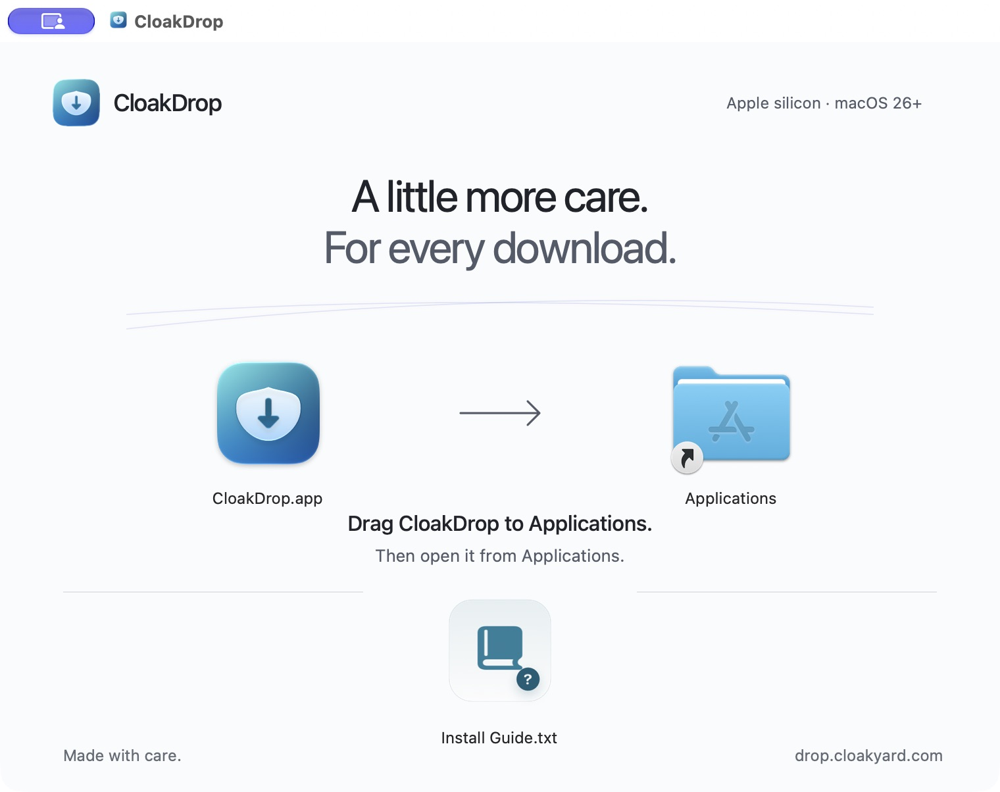

# October 19, 2026 — Air installer

The maintainer explicitly requested an Air installer background while preparing
1.0.0-rc.1. The native app remains unchanged. The background now uses the canonical
light palette, regular system typography, open spacing, a restrained horizon and
one clear arrow. The old grid, tinted card, monospaced labels, simulated transfer
lines and decorative status treatments are removed.

The source is `apps/macos/scripts/dmg/background.swift`; its adjacent PNG is the
generated preview. This is a fixed light bitmap because Finder supports one
background image, rather than an appearance-aware web surface. Actual app and
Applications icons remain native. Their centres are unchanged at (204,282) and
(556,282); the Install Guide remains at (380,464).

Checks on the regenerated RC:

- Swift/AppKit rendering passes: 1520×1140 pixels at 144 dpi for a 760×570-point
  content area. The final DMG was opened normally in Finder; its stored layout
  shows all three icons, labels, arrow and instructions without clipping.
- Text uses Air ink/secondary/muted on the solid Air page colour. No essential
  text sits on the horizon. The directional arrow accompanies explicit wording.
- The packaged background exactly matches the committed preview bytes.
- `hdiutil verify` and `codesign --verify --deep --strict` pass. All 295 app
  file/link entries match the app that passed the RC launch and checksum transfer
  smoke test. `/Applications` alias and the original install guide are preserved.
- Air inventory now covers 20 sources; design integrity, 18 standalone
  portability checks and exact specification sync pass.

The DMG reuses the previously verified Finder layout. Opening its mount path in
an existing Finder window inherits that window's view; normal DMG opening was
therefore checked separately with the stored installer layout. The underlying
app, helpers, signing status and file-transfer output did not change. Checksums
for the rebuilt installer are recorded in the RC release notes and manifest.
