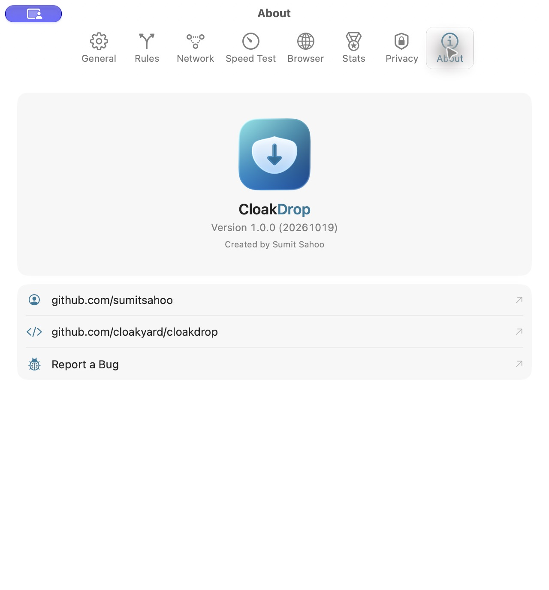
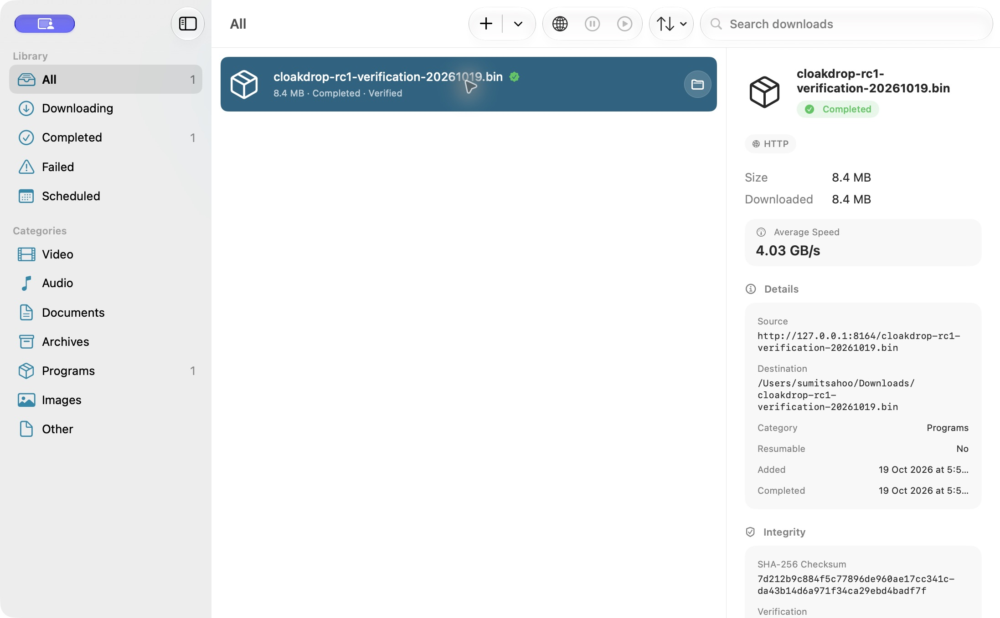

# October 19, 2026 — 1.0.0-rc.1

Prepared a local release candidate after reviewing
[the September 10 beta](https://github.com/cloakyard/cloakdrop/releases/tag/v1.0.0-beta.20260910)
and [September 6 beta](https://github.com/cloakyard/cloakdrop/releases/tag/v1.0.0-beta.20260906).
Their versioned DMG naming, explicit build number, checksum, verification and
limitations sections are retained in the [release draft](../releases/v1.0.0-rc.1.md).
No push, tag, GitHub release or website deployment was performed during preparation.
The later authorized publication is recorded below.

## Artifact and provenance

- `apps/macos/build/RC-1.0.0-20261019/CloakDrop-v1.0.0-rc.1.dmg`.
- 48,181,551 bytes; SHA-256
  `c363dc38e9cd48ade60b74458f0f3f83c5dd666f60332af274134086556c9471`.
- Version 1.0.0 / numeric build 20261019, arm64, macOS 26 minimum.
- Apple M2 Max, macOS 27.0.1, Xcode 27.0 (27A266a), Swift 6.4, macOS SDK 27.0.
- App source: `27953ff74b73fb6400e6a7c81cf72d54d153bdd5`; installer source:
  `df413b2981b78025c2c2d0b2a93903cf55fd2807`. Native app production inputs are
  unchanged by those dependency/documentation/installer commits.
- Machine-readable [manifest](evidence/2026-10-19-rc.1.json) is also beside the DMG
  with `SHA256SUMS.txt`. Binaries remain ignored build artifacts.

The optimized Release build used:

```sh
cd apps/macos
GIT_CONFIG_COUNT=0 xcodegen generate
GIT_CONFIG_COUNT=0 xcodebuild -project CloakDrop.xcodeproj -scheme CloakDrop \
  -destination 'platform=macOS,arch=arm64' -configuration Release \
  -derivedDataPath build/RC-1.0.0-20261019 CURRENT_PROJECT_VERSION=20261019 \
  CODE_SIGNING_ALLOWED=NO build
```

The app was copied to `Distribution/CloakDrop.app`. Complete current notices were
added to `Contents/Resources/ThirdPartyNotices`: CloakDrop/GRDB/yt-dlp licenses,
upstream frozen-component notices, and the exact FFmpeg 9.0.2 source archive,
LGPL notices, build configuration and pinned build script. Source archive SHA-256
matches the [dependency audit](2026-10-19-dependencies.md). GRDB's supplied privacy
manifest remains bundled. No old FFmpeg 9.0.1 source archive remains in the RC.

The build phase signs nested helpers from leaves outward. After adding notices,
the extension and app were explicitly ad-hoc signed with their **base teamless
sandbox entitlements** and hardened runtime. No `--deep` signing was used; strict
deep verification passes. No Developer ID identity is available on this Mac.

The existing DMG script used the verified September installer `.DS_Store` via
`DMG_LAYOUT_TEMPLATE`. Its background was then redesigned at the maintainer's
request and the DMG rebuilt. [Installer evidence](2026-10-19-installer.md) covers
normal Finder opening, real icon/label placement and exact background bytes.
The deprecated `hdiutil` flags emit macOS 27 notices but succeed; no build or
verification failure is suppressed.

## Observed checks

| Check | Result |
| --- | --- |
| Full optimized Swift suite | 626 tests / 87 suites pass, no feature skips |
| Suite breakdown | 14 persistence, 341 model, 271 engine |
| Actual media checks | H.264/AAC mux and remux tests pass with FFmpeg 9.0.2 |
| Native builds | Fresh Debug and optimized Release; zero compiler warnings/errors |
| Lint / localization | Zero violations in 174 files; 494 strings × ten translations |
| Website | Clean npm tree/audit, check/build/dry run, 432 layouts / 34 journeys |
| Animation | Real GPU lifecycle and six static fallback profiles pass |
| Air | 20 source records, 18 portability assertions, exact canonical sync |
| App bundle | 126 valid relative links; no Debug dylib; strict nested signatures pass |
| Distribution | `hdiutil verify`; mounted app matches all 295 files/links |
| Helpers | Exact copied package helpers launch under a temporary sandboxed parent and report expected versions |

The helper smoke parent embeds exact copies of the signed runtime in its own
bundle and uses the app's base sandbox entitlements. An initial probe pointing
outside that sandbox could not access the helper; it was corrected without
changing the shipped app or widening entitlements. This validates local helper
loading, not every provider or Developer ID execution.

The freshly built Debug app's empty state and New Download cancellation were
checked first. The Release app was launched directly from the initial candidate
DMG; process path and About confirmed the intended build. It downloaded the
controlled 8 MiB loopback file and displayed **Completed · Verified**. Independent
SHA-256 matched `7d212b9c884f5c77896de960ae17cc341cda43b14d6a971f34ca29ebd4badf7f`.
Only that test record and payload were removed. One verification transfer remains
in aggregate lifetime statistics; existing settings/data were not reset.





The Air rebuild packages the identical signed application (all 295 file/link
entries match); no app rebuild or behavior change followed the smoke test.
Current native screenshots are light appearance at the existing compact window
size. Website desktop/laptop/mobile light and dark were freshly checked. The
September native dark and broader transfer checks remain dated historical evidence.

Detailed local logs: `/tmp/cloakdrop-1.0-2026-10-19/`. The earlier TSan/static
analysis and wider native journey evidence in the September audit were not rerun
or relabelled as new results.

## Remaining release boundaries

The RC is ad-hoc signed and **not notarized**. Clean-Mac Gatekeeper, Developer ID,
App Group share inbox, macOS 26 runtime, physical power-loss and full assistive/
device acceptance remain open. The maintainer explicitly accepted the official
yt-dlp frozen-runtime exception; see the current dependency audit. This candidate
is prepared for review, not a claim that these final-distribution gates passed.

## Authorized GitHub publication — October 19

The maintainer subsequently requested creation of the GitHub release. Published
[v1.0.0 RC 1 (Build 20261019)](https://github.com/cloakyard/cloakdrop/releases/tag/v1.0.0-rc.1)
as a **prerelease** at 12:43:28 UTC (18:13:28 India time). The annotated tag resolves
to `9936e47c24fa7264eeaa7790f97f80bf58a1bf2f`; its only changes after the verified
candidate are release documentation. No app or installer bytes were rebuilt.

The release follows the previous beta format and includes the original DMG and
`SHA256SUMS.txt`. Both GitHub asset digests and sizes match the local artifacts;
the published body exactly matches the committed release notes. Publication was
verified with `isDraft: false`, `isPrerelease: true` and a non-null published time.
See the [publication record](evidence/2026-10-19-rc.1-publication.json).

The build manifest's `published: false` describes its preparation-time state;
the separate publication record is the current release status. Only the release
tag was pushed. Main/dev and the website deployment were not changed. No GitHub
Actions run appeared for this tag at publication; the recorded local checks are
the validation evidence. Website deployment still requires authorization.
