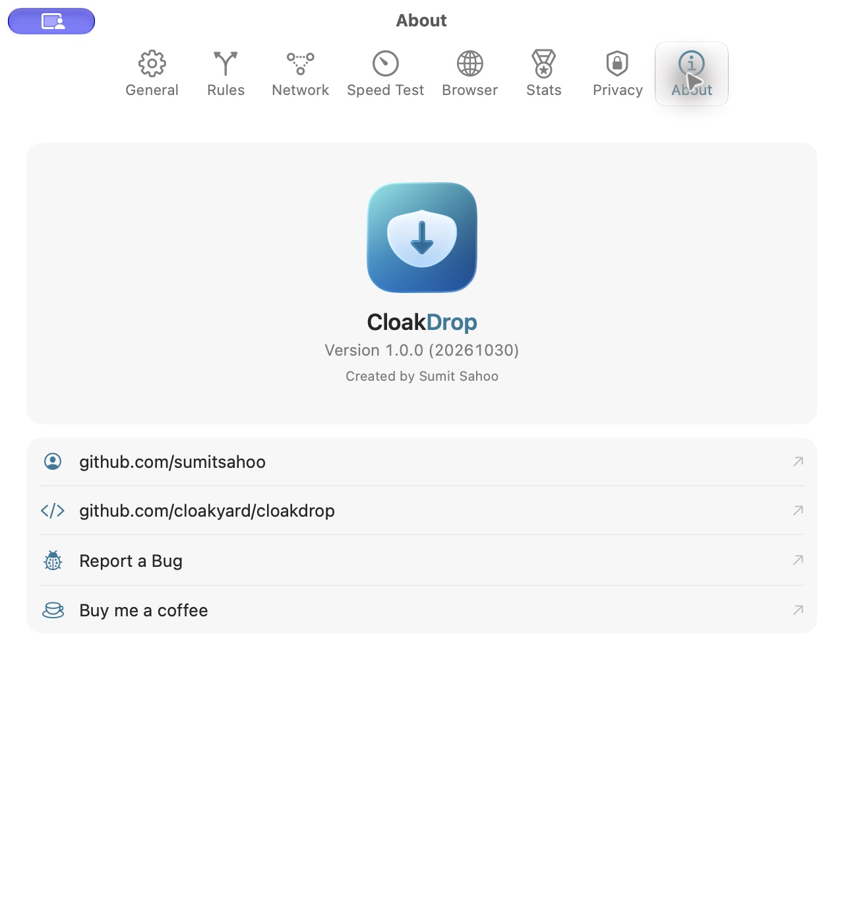
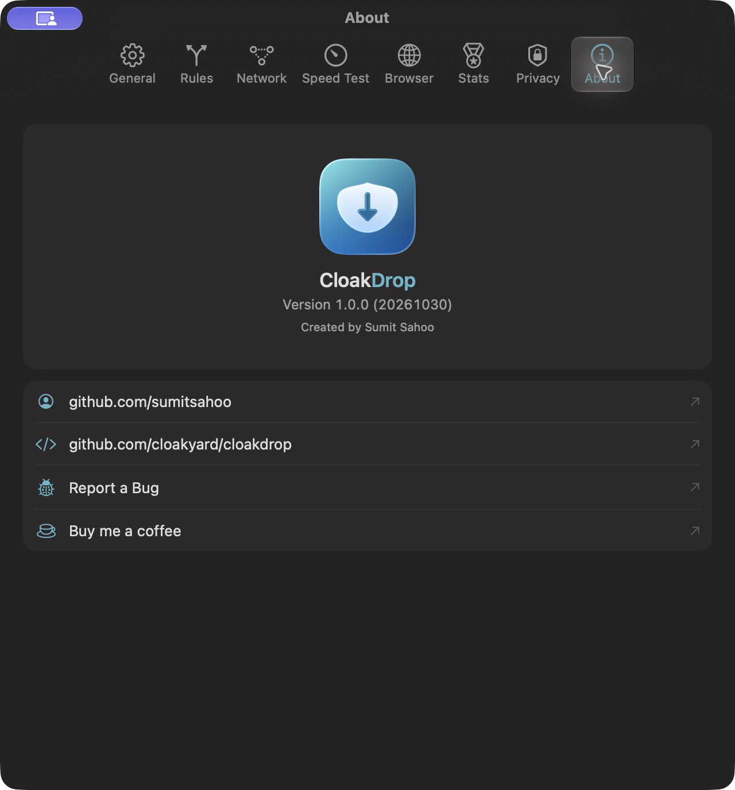
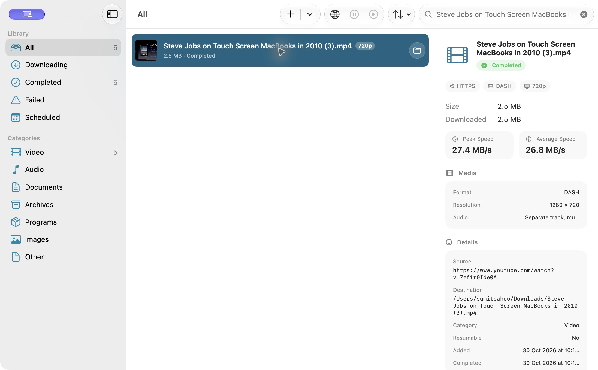

# October 30, 2026 — 1.0.0-rc.2

Prepared at the maintainer's request using [RC1](2026-10-19-rc.1.md) as the
versioning, signing and installer reference. The request authorizes GitHub
prerelease publication, a new attached DMG, replacement of the local installation
and removal of old local builds. It also adds a Ko-fi link to native About.

## Artifact and provenance

- Candidate: `v1.0.0-rc.2`; app **1.0.0 (20261030)**, arm64, macOS 26 minimum.
- App/installer source: `055e22c1a1861196702ff50c36a7f1260637750c`.
- Artifact: `apps/macos/build/RC-1.0.0-20261030/CloakDrop-v1.0.0-rc.2.dmg`.
- 48,626,482 bytes; SHA-256
  `f9b832c9b3f42cc1f12040cc87f20960588d8fe1c48775a13d519c4df45df933`.
- Apple M2 Max; macOS 27.2 (26B123), Xcode 27.1 (27A9275), Swift 6.4,
  macOS SDK 27.0.
- [Build manifest](evidence/2026-10-30-rc.2.json) and
  [release notes](../releases/v1.0.0-rc.2.md).

```sh
cd apps/macos
GIT_CONFIG_COUNT=0 xcodegen generate
GIT_CONFIG_COUNT=0 xcodebuild -project CloakDrop.xcodeproj -scheme CloakDrop \
  -destination 'platform=macOS,arch=arm64' -configuration Release \
  -derivedDataPath build/RC-1.0.0-20261030 CURRENT_PROJECT_VERSION=20261030 \
  CODE_SIGNING_ALLOWED=NO build
```

Copied the optimized app to `Distribution/CloakDrop.app`, added current notices,
and explicitly ad-hoc signed the extension and app with base teamless sandbox
entitlements and hardened runtime. No Developer ID identity is available on this
Mac. Nested helpers were signed by the existing build phases; no `--deep` signing
was used. Strict deep verification passes. Bundle metadata was set before sealing.

Notices include CloakDrop/GRDB licenses, the license from yt-dlp's 2026.10.26 tag,
that official frozen runtime's third-party notices, and complete FFmpeg 9.0.2
source, licenses, actual configuration and the current build script. The AAC
probing decoder is retained, networking/encoders remain disabled. Dependency
versions and frozen-runtime exceptions are in [the October 29 audit](2026-10-29-youtube.md).

The DMG script used the verified RC1 `.DS_Store` via `DMG_LAYOUT_TEMPLATE` with
unchanged installer artwork. `hdiutil verify` passed; all 295 file/link entries
match the signed staging app, mounted DMG app and installed app. All 126 runtime
symlinks are relative, resolve inside the app and exist. No Debug dylib is present.
The installer was ejected after installation. macOS emitted deprecation notices
for the existing `hdiutil` syntax; all commands exited successfully.

## Checks performed

| Check | Result |
| --- | --- |
| Optimized core suite with vendor FFmpeg | 14 + 341 + 295 tests, 90 suites; 649 executed/pass, one opt-in live test skipped |
| Builds | Fresh arm64 Debug and optimized Release; successful exit codes, no compiler warnings/errors |
| Strict SwiftLint | 178 files, zero violations |
| Localization | 502 strings × ten translated languages |
| About | Light Release and dark Debug; correct version, visible support link, actual browser URL confirmed |
| Distribution | DMG checksum, strict nested signatures and 295 file/link matches pass |
| Installed media transfer | Complete H.264/AAC MP4, exact packet counts, full decode and known-good hash pass |

The source already includes the media fixes and six successful live cases recorded
in [the multi-site audit](2026-10-29-multisite.md). Those dated results cover pasted
and built-in browser intake, HLS/DASH, audio-only handling, and protected/access
failure behavior. They are not relabelled as freshly repeated RC2 live-site runs.
The wider automated recovery, persistence, encryption rejection, mux failure,
no-overwrite, range and cancellation regressions ran in the full optimized suite.
Website checks were not repeated for this native About/release task.

## Native verification and installation

Added the native `Link` row **Buy me a coffee** with SF Symbol `cup.and.saucer`,
using `AppLinks.support = https://ko-fi.com/sumitsahoo21`. No network request is
made by adding the row; clicking opens the system browser. Ten translations were
added. The actual click opened that URL, titled “Buy Sumit Sahoo a Coffee”. Only
the verification-created browser tab was closed.





Quit Debug before installing the signed app from the mounted DMG into
`/Applications/CloakDrop.app`. The running process path and About confirmed the
installed RC2. Its four existing library entries and downloaded files survived.
Pasted the originally reported YouTube URL, selected the default compatible MP4
at 720p and downloaded through the signed, sandboxed packaged helpers. The result
was 2,453,267 bytes, 44.489433 seconds, H.264/AAC, **1,333 video / 1,916 audio packets**.
Full FFmpeg decode exited 0 with no errors. SHA-256 matches the prior complete file:
`57ae0d54389239755143e15bf9f1a8525bb07f063b99f5b88cf94fde52e62633`.
See [machine-readable media evidence](evidence/2026-10-30-rc.2/youtube-installed.json).



Removed only this verification's `(3).mp4` record/file and cleared the temporary
search filter. One test completion and its transferred bytes remain in aggregate
lifetime statistics. User data, browser cookies, settings and the four existing
download records/files were preserved.

Removed the old installed RC1 backup, obsolete build directories, SwiftPM build
cache, old Desktop/Downloads installer copies and obsolete helper source/archive
versions. The [cleanup record](evidence/2026-10-30-rc.2/cleanup.json) lists 45 entries
totalling approximately 24.21 GiB of pre-removal allocated size; APFS sharing means
this is not a promise of an identical physical free-space increase. The current
vendor inputs, RC2 build/artifacts and installed app remain, with a convenient
copy of the new DMG in Downloads. Historical GitHub releases were not removed.

Logs remain in `/tmp/cloakdrop-rc2-20261030/`. The committed evidence contains no
expiring CDN URLs, cookies or credentials.

## Distribution boundaries

This RC retains RC1's ad-hoc signing and lack of notarization. Clean-Mac Gatekeeper,
Developer ID, App Group share-inbox handoff, macOS 26 runtime and physical power-loss
remain unverified. The official yt-dlp frozen runtime exception remains explicit.
Compatible MP4 selects compatible source streams; it is not a general transcoder.
Protected media and site-specific access restrictions remain supported failures.

The authorized publication uses an annotated `v1.0.0-rc.2` tag and uploads the DMG
plus `SHA256SUMS.txt` as a GitHub prerelease. Subsequent release-documentation commits
do not change the packaged app. Only the release tag is pushed; no website deployment
is part of this task. Publication metadata is verified separately after upload.
