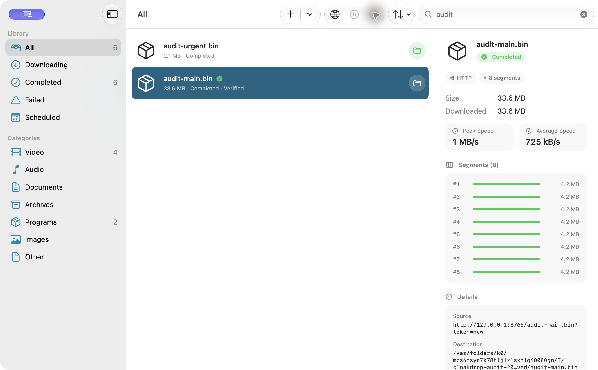
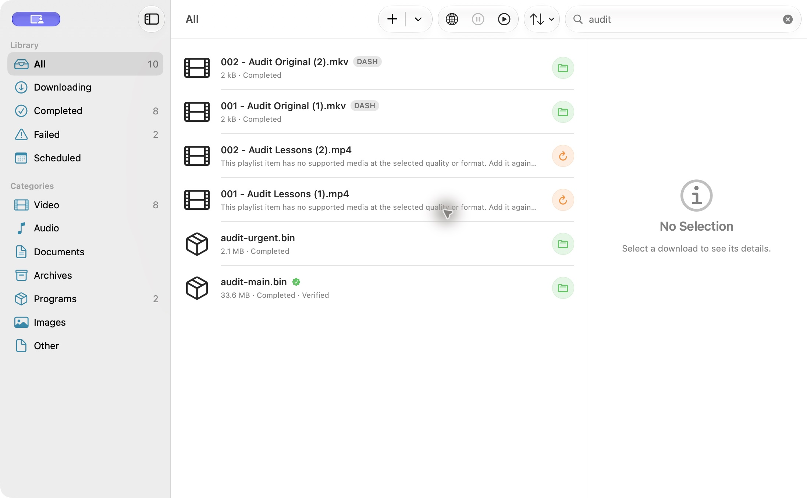

# November 3, 2026 — regression audit and dependency refresh

This round audits the source after the [four download workflow additions](2026-11-03-download-workflows.md).
It fixes two concurrency/state defects and one user-facing error defect, updates compatible
dependencies, and records automated, native, live-network and website verification. The evidence
is dated and bounded; it does not certify every site, physical failure mode or release-signing path.

## Findings fixed

| Finding | Trigger and correction | Regression evidence |
|---|---|---|
| Manual intent lost on reconnect | An offline download was already paused, so Pause/Pause All did not clear its automatic-resume eligibility. Successful Move now also clears eligibility. Cancel/remove clear stale membership, and the disconnect loop rechecks each download after actor suspension. | `NetworkRecoveryIntentTests`: pause, pause-all and move stay paused after reconnect; untouched work resumes byte-perfectly. Pause and pause-all reproduced failures before the fix. |
| Concurrent playlist duplicates | Two imports could interleave at a persistence await, leaving the first import's duplicate snapshot stale. Each entry now checks the live catalog immediately before reservation. | `PlaylistConcurrencyTests`: a gated store deterministically interleaves two imports; the old implementation stored three records for two pages. The fixed implementation stores two unique pages. |
| Opaque playlist failure | Unsupported quality/format surfaced an internal `MediaExtractionError` number. Extraction cases now map to readable explanations and next steps. | `PlaylistImportTests.unavailableItemIsIsolated`: one unavailable item fails clearly while its peer completes. A fresh native build displayed the improved message on retry. |

The source changes retain the existing persistence, publication, isolation and dependency seams.
No new third-party dependency was introduced. Red/green excerpts and final suite summaries are in
[the evidence directory](evidence/2026-11-03-full-audit/).

## Dependency currency

Versions were checked against upstream releases and registry metadata on November 3.

| Component | Result | Source / boundary |
|---|---|---|
| GRDB | **7.11.1 → 7.12.0**; minimum and lock revision updated | [Official release](https://github.com/groue/GRDB.swift/releases/tag/v7.12.0); revision `92a554cd0d5e8d67cb18993c6054e73fe42c066c` |
| Astro | **7.4.4 → 7.4.5** | [Official release](https://github.com/withastro/astro/releases/tag/astro%407.4.5) |
| Wrangler | **4.155.0 → 4.156.2** | [Official release](https://github.com/cloudflare/workers-sdk/releases/tag/wrangler%404.156.2) |
| workerd | **1.20261023.1 → 1.20261102.1** | Wrangler's lockfile dependency; explicit install-script allowlist updated with it |
| Other website dependencies | Compatible lockfile refresh; **21 packages changed**, npm audit **0 vulnerabilities** | [Registry audit result](evidence/2026-11-03-full-audit/npm-audit.json); this covers npm advisories, not native/runtime vulnerabilities |
| Astro Check / Sitemap | **0.9.12 / 3.7.4**, already current | npm registry metadata |
| TypeScript | **6.0.3**, latest supported by current Astro Check | Check's peer range is `^5.0.0 || ^6.0.0`; 7.0.2 was not forced into an unsupported tree |
| npm | **12.2.1**, current tracked package manager | Node is a host build tool; the installed Node 26.13.0 satisfies the site's engines range |
| FFmpeg | **9.0.2**, already latest stable | [Official release index](https://ffmpeg.org/releases/); existing local-only build retained |
| yt-dlp | **2026.10.26**, already latest official stable | [Official release](https://github.com/yt-dlp/yt-dlp/releases/tag/2026.10.26); complete official runtime retained |
| GitHub Actions | checkout **7.0.1**, setup-node **7.1.0**, already current | Official action releases; existing workflow references retained |

FFmpeg's source SHA-256 remains `1e1ab256dfddec185ab2d9db21eed5517a52882b7a000c6467159316289136b8`.
The yt-dlp archive SHA-256 remains `20d98fa608998eff87d1d35a6e9fb65e4b874639a6cc89addc19da3becde3ef1`.
No unchanged vendor archive was replaced. FFmpeg exposes only `file`, `pipe` and `fd` protocols;
its local AAC decoder remains available for probing, with no encoders enabled.

### Official frozen-runtime exception

The maintainer previously chose the complete official yt-dlp bundle over a custom runtime
([October 7 decision](2026-10-07-dependencies.md), [October 19 reconfirmation](2026-10-19-dependencies.md)).
That choice remains in effect. **Not every nested library is current.**

| Frozen component | Bundled | Upstream checked |
|---|---|---|
| Python | 3.14.7 | [3.14.10 in the same series; 3.15.2 current stable](https://www.python.org/downloads/) |
| OpenSSL | 3.5.7 | [3.5.9 in the same LTS series](https://openssl-library.org/source/) |
| SQLite | 3.50.4 | [3.54.1](https://www.sqlite.org/changes.html) |
| websockets | 17.3 | [17.4](https://pypi.org/project/websockets/) |

The helper reports current PyPI versions for pycryptodomex 3.24.1, brotli 1.2.1,
certifi 2026.10.23, curl_cffi 0.17.0, mutagen 1.48.1, requests 2.34.2, urllib3 2.8.0,
and yt-dlp-ejs 0.8.0. See [registry metadata](evidence/2026-11-03-full-audit/pypi-current.json).
These are the helper's reported packages, not an exhaustive binary SBOM. macOS system frameworks
and GRDB's system SQLite are OS-managed and distinct from yt-dlp's frozen SQLite.

## Automated verification

All final local checks below passed with GRDB 7.12.0 and the final source fixes:

- Full Swift package run reports **14 persistence + 341 model + 318 engine tests across 97 suites**.
  The opt-in live-media test is disabled in this normal run; live origins/media were explicitly
  exercised separately below. [Suite results](evidence/2026-11-03-full-audit/core-suites.txt).
- Fresh arm64 Debug `xcodebuild build analyze`, exit 0; both build and analysis succeeded.
  `codesign --verify --deep --strict` passed for the resulting app and nested helpers.
- Strict SwiftLint: zero violations. Localization validation: **537 strings × 10 languages**,
  with consistent placeholders.
- Native regression executables: `DockProgressRegression`, `AmbientRefreshRegression`,
  `SettingsInputRegression`, and `BrowserPlaybackRegression` passed. The WebKit test exercises
  real iframe playback, hidden/reparented views, and unloading on close.
- Asset sync, Astro check (**19 files, zero errors/warnings/hints**), static build and Wrangler
  deploy dry-run passed. Nothing was deployed.
- Air design inventory and portability checks passed; npm dependency tree validation passed.

The package suite spans the following feature groups; the native column identifies what received
additional UI verification in this round rather than implying every setting was toggled live.

| Feature group | Automated coverage run | Additional observed checks |
|---|---|---|
| Transfer/recovery | HTTP ranges, FTP loopback, segmentation/stealing, retry/truncation, pause/resume/relaunch, response identity, bounded streams, cancellation, destination collision safety | Real native 32 MiB repair/resume/move flow; two external HTTP origins |
| Scheduling/organization | Queue limits, priority restore/failure, recurrence, bandwidth schedules/shared limiter, categories, routing rules, filters, duplicate detection, database migrations and statistics | Finish This First held and restored its peer; rules and statistics settings rendered |
| Repair and move | Validator compatibility/restart, staging preservation, relaunch, move collisions and persistence failure rollback, security-scoped destination recovery | Expired URL repaired; partial moved through folder picker; relaunch and final hash passed |
| Integrity/post-processing | MD5/SHA-1/SHA-256, sibling discovery, signature assessment, quarantine, provenance, ZIP parsing/extraction | Native explicit SHA-256 verification and independent final-file hash |
| Media/playlists | HLS/DASH, AES-128, range validation, separate audio/languages, subtitles, remux and compatible MP4, extractor cancellation/parsing, deferred playlist resolution and duplicate imports | Native two-item original playlist completed; unsupported format failed clearly; six external format cases fully decoded |
| Browser/intake | Sniffer/collector runtime, ad and fragment exclusions, cookie scoping, batch/pattern parsing, link extraction, capture inbox, browser playback lifecycle | Local WebKit page, media shelf and duplicate-download warning; cancel and close behavior |
| Network/diagnostics | Proxy routing/authentication and Keychain seam, speed-test math/transport/providers, credentials, settings/statistics persistence | Network, speed-test and browser settings inspected without changing configuration |
| Native shell | Ambient refresh, Dock progress and settings input regressions; localization validation | Light/dark transfer states, context menus, search, inspector, playlist selection, General/Rules/Network/Speed Test/Browser/Stats/Privacy/About |

## Native end-to-end evidence

A throttled loopback fixture served a deterministic **33,554,432-byte** file and a 2 MiB priority
peer. The main download was paused, the app quit and relaunched in dark mode, and its old URL
expired. Repair replaced the token while retaining compatible saved bytes. Finish This First
held the main transfer, completed the peer, and restored the main transfer. Move Download then
relocated the partial through the native folder picker and left it paused. After another quit
and relaunch in light mode, Resume completed the moved file.

Both the explicit in-app checksum and an independent filesystem digest matched:
`e09320c5b00b34bb704802136c599a95b3996332ba84d7c7f21112b6231b6bd0`.
[Native results](evidence/2026-11-03-full-audit/native-results.json) include resumed request intervals,
final bytes/hashes and media probes. This is process-relaunch evidence, not physical power-loss testing.

The signed bundled resolver read two local playlist entries. Deselect All disabled Add Selected;
selecting Original quality and submitting produced two completed MKVs, each with **30 H.264
packets and 1.000000 seconds**. Choosing compatible MP4 for fixture metadata with unknown codec
information failed without publishing files; retry in the final build showed the new explanation.
The built-in browser detected the local media and correctly warned that its source was already
downloaded. The warning was cancelled.

## Live network verification

The [six-case input list](evidence/2026-10-29-multisite/live-cases.json) was rerun with the bundled
yt-dlp/FFmpeg, core payload transfer, packet/duration probes and full decoding using the existing
host ffmpeg. These host probe/decoder tools are test tools, not app dependencies.

| Public source | Modes | Observed complete output |
|---|---|---|
| [YouTube 7zfir0Ide0A](https://www.youtube.com/watch?v=7zfir0Ide0A) | Compatible MP4, original AV1 MKV, audio-only M4A | About 44.49 seconds; video variants 1,333 video / 1,916 audio packets |
| [Dailymotion x5kesuj](https://www.dailymotion.com/video/x5kesuj) | Original MKV and compatible MP4 | About 187 seconds; 5,597 video / 4,019 audio packets |
| [SoundCloud sample](https://soundcloud.com/the80m/the-following) | Audio-only M4A | About 397.176 seconds; 17,105 audio packets |

The first explicit live run passed all six cases. A later combined full-suite/live run returned
**HTTP 403 for Dailymotion original**; its other five media cases and both origin cases passed.
A focused retry with freshly resolved metadata passed and fully decoded. That combined run is
recorded as failed, not silently counted as a clean pass. See [initial pass](evidence/2026-11-03-full-audit/live.txt),
[recheck failure](evidence/2026-11-03-full-audit/live-recheck.txt) and
[focused retry](evidence/2026-11-03-full-audit/live-retry.txt). This round does not establish that
the origin failure is reproducible or that every provider/account/region will work.

Real URLSession also completed the RFC 9110 text (**502,941 bytes**, one stream) and TypeScript
6.0.3 package (**4,515,854 bytes**, four honored ranges). No signed media URLs, cookies or
credential-bearing extraction output are included in committed evidence.

## Website checks

Chrome checked home, privacy and 404 at **1440×900, 1280×720 and 390×844**, each in light/dark
with reduced motion: **18 layout states**. No horizontal overflow, broken images, missing local
anchors or captured console warnings/errors were found. Mobile Menu opened, closed after the
Download link, and reached the correct section; privacy navigation and 404 return-home worked.
[Results](evidence/2026-11-03-full-audit/web-checks.json) and screenshots are retained. Visual review
covered desktop, laptop and mobile themes; browser emulation overrides were restored afterward.

The standalone `test-air-links.mjs` runner could not start because its external `puppeteer-core`
dependency is absent. The Chrome checks above used the enabled computer-use browser APIs and
are scoped evidence, not a claim that the runner's entire hover/focus/enlarged-text matrix ran.
No browser automation dependency was added. Existing physical touch, assistive-tech and GPU
acceptance gates in the Air inventory remain separate.

## Cleanup and remaining limits

Only six audit download rows and their generated outputs were removed, with the app stopped.
The four unrelated download rows were compared before/after cleanup and remained unchanged;
queues, settings, rules and statistics were also unchanged by cleanup. Test traffic contributes
roughly **34 MiB plus media bytes** to lifetime statistics; those counters were not reset.
Fixture servers stopped, the audit browser tab closed, emulation cleared, and the verified app
reopened normally. [Cleanup record](evidence/2026-11-03-full-audit/cleanup.json).

Release App Group/Share Extension handoff, Developer ID signing, notarization, physical reboot/
power loss, external-drive removal, every supported macOS version, real FTPS certificate paths,
every proxy/provider and every assistive input path were not fully exercised here. Destructive
data-wipe/reset controls and user Shortcuts were not invoked against the existing profile.
The automated seams were tested where present. The frozen-runtime exceptions above remain open;
neither a current yt-dlp version nor the npm advisory result removes those exceptions.
