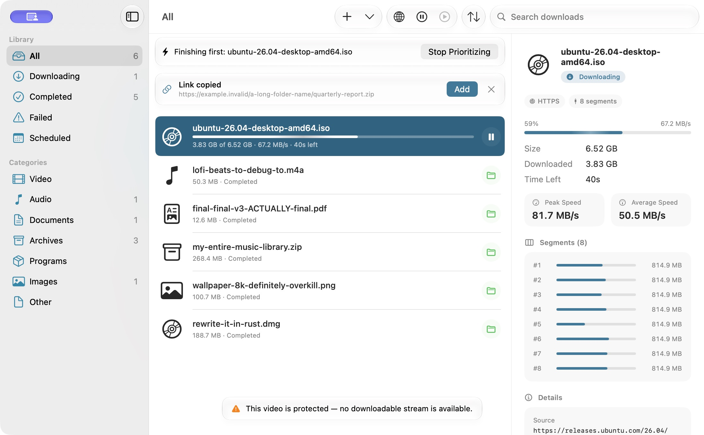
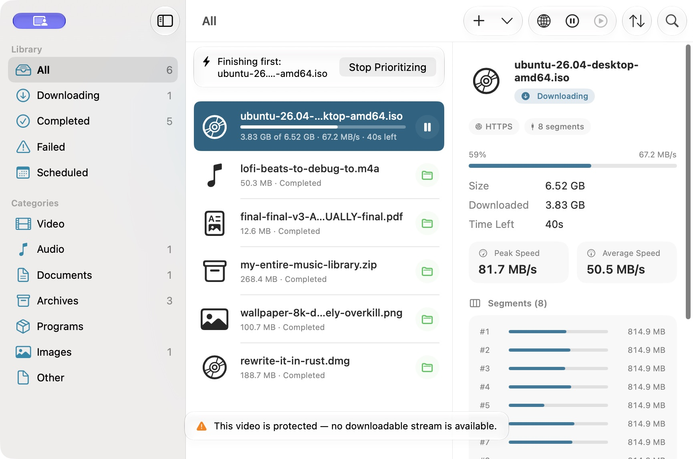
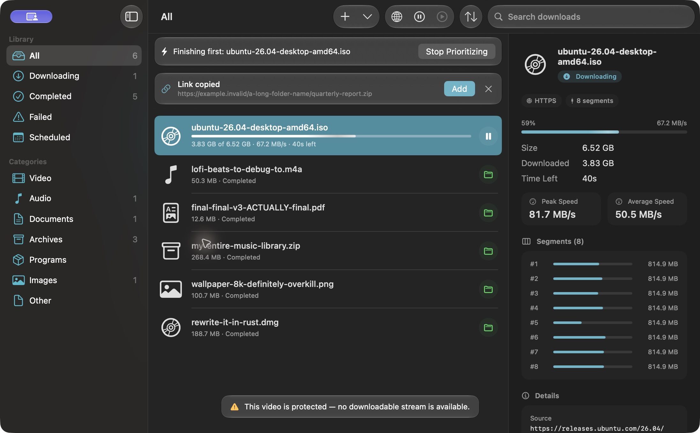
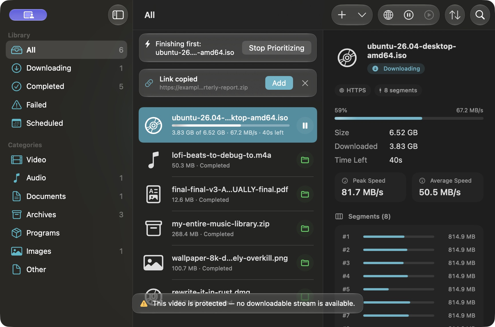

# Dependency and native control audit — November 17, 2026

This pass audits the repository's declared dependencies, optional native helpers, CI actions,
and native UI surface families after `3b2f46d`. It refreshes compatible website dependencies
and completes a bounded follow-up to the [native materials audit](2026-11-17-modern-materials.md).
It does **not** establish that every nested vendor library is current. The two exceptions below
remain explicit. No website deployment or native release was made.

## Dependency results

Upstream release APIs and npm/PyPI registry metadata were checked on November 17.
[Captured metadata](evidence/2026-11-17-modern-controls/upstream.json) records versions and peer requirements.

| Component | Result |
| --- | --- |
| GRDB | **7.12.0**, current official stable; manifest and resolved revision already agree with [upstream](https://github.com/groue/GRDB.swift/releases/tag/v7.12.0). |
| Astro / Sitemap / Astro Check | **7.4.12 / 3.7.5 / 0.9.12**, already current. |
| Wrangler | **4.162.0 → 4.164.0**; associated workerd and Miniflare versions refreshed. The exact workerd install-script allowance now matches **1.20261117.1**. |
| Website dependency tree | **49 lockfile package entries** changed, including optional platform variants. Updates remain within the declared dependency ranges; [full before/after inventory](evidence/2026-11-17-modern-controls/npm-changes.json). Fresh `npm ci`, tree validation and npm audit passed, with **0 reported vulnerabilities**. |
| TypeScript | **6.0.3 retained**. Latest is 7.0.2, but Astro Check's peer range is `^5.0.0 || ^6.0.0`. It is the only direct dependency still reported by `npm outdated`, with installed = wanted. |
| npm | Declared **12.2.2**, current; invoked through `npx npm@12.2.2` for installation and checks. The host's global npm was not changed. Node **26.13.1** satisfies the site's engine range. |
| FFmpeg | **9.0.2**, already the [latest official stable](https://ffmpeg.org/download.html). Local binary reports this version and the existing network-disabled, encoder-disabled build configuration. No vendor replacement or pin change. |
| yt-dlp | **2026.10.26**, already the [latest official stable](https://github.com/yt-dlp/yt-dlp/releases/tag/2026.10.26); existing complete official bundle retained. |
| GitHub Actions | checkout **7.0.1** and setup-node **7.1.0** already match their latest official releases. Existing commit pins retained. |
| Apple frameworks | SwiftUI, AppKit, WebKit, AVFoundation, CryptoKit and system SQLite are SDK/OS-provided, not separately vendored packages. Built with Xcode **27.2**, retaining the app's macOS **26.0** minimum. |

### Official yt-dlp runtime exception

The maintainer's [October 7 decision](2026-10-07-dependencies.md), reconfirmed
[October 19](2026-10-19-dependencies.md), keeps the complete official runtime together.
Replacing individual frozen libraries or introducing a custom Python toolchain would contradict
that choice. The current helper's [reported runtime inventory](evidence/2026-11-17-modern-controls/ytdlp-runtime.txt)
still contains these older versions:

| Component | Bundled | Current upstream checked |
| --- | --- | --- |
| Python | 3.14.7 | [3.14.10 in the same series; 3.15.2 current stable](https://www.python.org/downloads/) |
| OpenSSL | 3.5.7 | [3.5.9 in the LTS series; 4.1.0 current stable](https://openssl-library.org/source/) |
| SQLite | 3.50.4 | [3.54.1](https://www.sqlite.org/changes.html) |
| websockets | 17.3 | [17.4](https://pypi.org/project/websockets/) |
| pycryptodomex | 3.24.1 | [3.24.2](https://pypi.org/project/pycryptodomex/) |

The reported brotli 1.2.1, certifi 2026.10.23, curl_cffi 0.17.0, mutagen 1.48.1,
requests 2.34.2, urllib3 2.8.0 and yt-dlp-ejs 0.8.0 match
[current PyPI metadata](evidence/2026-11-17-modern-controls/runtime-upstream.json).
This reported inventory is not a complete binary SBOM, and npm audit does not cover native helpers.

## Native control and material results

Apple's [adoption guidance](https://developer.apple.com/documentation/TechnologyOverviews/adopting-liquid-glass)
favors system components and a distinct navigation/control layer. Standard controls already pick
up the current system appearance. Custom glass uses the shared `FloatingChrome` modifier and
`GlassEffectContainer`, following [Apple's glass API](https://developer.apple.com/documentation/swiftui/glass).

| Surface family | Audit result / change |
| --- | --- |
| Main/sidebar navigation | Retained `NavigationSplitView`, native sidebar `List(selection:)`, searchable toolbar, menus and `ToolbarSpacer`. The system owns their material and focus treatment. |
| Download row actions | Replaced the manually painted circle/hover animation with native `.bordered` buttons and `.buttonBorderShape(.circle)`. Preserved SF Symbols, action labels, help, selection-aware tint and approximately 30 pt targets. Rows remain ordinary content without glass. |
| Priority/clipboard/status | Added the missing Liquid Glass surface to the priority banner and grouped neighboring banners in `GlassEffectContainer`. Priority text wraps to two lines at compact widths. Shared opaque surfaces for Reduce Transparency/increased contrast remain in effect. Existing clipboard and toast treatment is retained. |
| Settings navigation | Replaced `.tabItem`/`.tag` pairs with typed `Tab` declarations for all eight tabs. Grouped forms, toggles, steppers, pickers, links and field controls remain native. |
| Add/schedule/metadata | Scheduling expansion and link-preview changes now respect Reduce Motion. Existing native date picker, repeat picker and validation behavior are preserved. |
| Speed Test/browser settings | Speedometer interpolation and the browsing-data confirmation animation now respect Reduce Motion. No speed test or data wipe was performed. |
| Sheets | Existing shared glass/glass-prominent action styles cover New Download, Grab Links, Repair, Playlist, Media, Rule Editor and browser authentication. Existing accessibility fallbacks and keyboard shortcuts retained; see the earlier materials audit for its broader rendering matrix. |
| Persistent details pane | Retained the bounded, accessible resize divider and solid scrolling content. This is an integral content pane; replacing it with a collapsible `.inspector` would undo its documented persistent-layout behavior. |
| Built-in browser | Native toolbar buttons/menu/popover and system address-bar glass retained. `NSTextField`/`WKWebView` interop supports address focus, capture, delegates, cookies and playback lifecycle; it is not evidence of obsolete visual controls. No redundant material added over system glass. |
| Menubar/share extension | Native menu commands and the extension's brief AppKit status view retained. Release App Group handoff is outside ad-hoc Debug verification. |
| Domain graphics/easter eggs | Segment/speed plots, file-type presentation and explicitly started games remain content. They do not need decorative glass layers or replacement with unrelated controls. |
| Website | Dependency changes only. Its separate Cloakyard Air contract and UI sources are unchanged. |

The in-memory fixture gained `--verify-priority`; the verification guide documents it. Normal
launches do not display sample data or the priority fixture.

## Verification and evidence

- `GIT_CONFIG_COUNT=0 swift test`: **673 tests across 97 suites** reported passed
  (14 persistence, 341 models, 318 engine); [suite results](evidence/2026-11-17-modern-controls/core-suites.txt).
  The opt-in live-media check remains disabled. No transfer or persistence implementation changed.
- Final arm64 Debug `xcodebuild build analyze`: both succeeded, exit 0, no warnings/errors.
  `codesign --verify --deep --strict` passed for the app and nested helpers.
- Strict SwiftLint: **0 violations across 193 files**. Localization validation:
  [537 strings × 10 languages](evidence/2026-11-17-modern-controls/localizations.txt), consistent placeholders.
- Fresh install with the declared npm version, asset sync, [Astro check](evidence/2026-11-17-modern-controls/astro-check.log)
  (**19 files; zero errors, warnings or hints**), static build and social-asset checks passed.
  [Wrangler deployment dry-run](evidence/2026-11-17-modern-controls/wrangler-dry-run.log) passed without deploying.
- Air contract and portability checks passed. `test-air-links.mjs` could not start because its
  separately supplied `puppeteer-core` harness is unavailable; no new dependency was introduced
  to satisfy that optional browser check. No new website viewport coverage is claimed.
- Native visual checks on macOS **27.2.1** covered light/dark main windows around **1097 × 679 pt**,
  compact windows around **864 × 572 pt**, priority wrapping, selected/unselected and completed
  rows, the native Settings tabs, and the add sheet's disabled action/date/repeat controls.
- Mouse selection, arrow navigation and Command-A selected the sample rows; a nonmatching search
  cleared the selection and showed No Results/No Selection. Escape dismissed the schedule sheet.
  All eight Settings tabs opened the corresponding page. General also rendered in dark.
- After fixture checks, the previous window size was restored and the final build was launched
  normally, showing the existing four completed records with no fixture banner. No records,
  browser data, speed-test results or lifetime counters were cleared or created by this pass.

| Main window | Compact window |
| --- | --- |
|  |  |
|  |  |

Screenshots contain sample download data; pointer/sharing indicators belong to the verification
tool. The speed-test screenshot and full accessibility dump remain outside the repository because
they include pre-existing results/preferences. The light compact capture has the clipboard
suggestion dismissed. The saved Settings captures show the reviewed initial states, not every
scroll position or conditional branch.

Reduce Motion branches were reviewed in source and compiled; live timing under changed system
accessibility preferences was not measured in this pass. Earlier same-day material-fallback
checks remain dated separately. macOS 26 rendering, every localization, spoken VoiceOver,
release signing/notarization and live external media are not newly certified by this audit.
