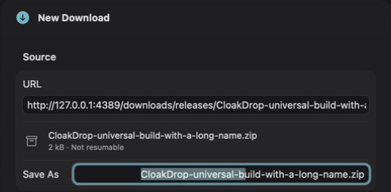
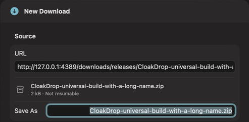
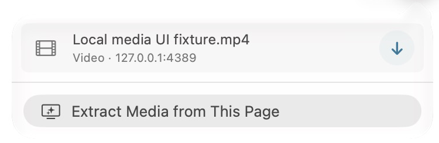
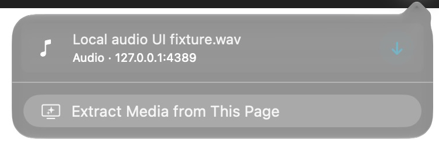

# Full-width URL and native screen audit — November 17, 2026

Follow-up to the [dependency and control audit](2026-11-17-dependencies-and-controls.md),
starting from `06acca4a`. This pass inventories the native app's screen families and applies
three presentation improvements plus accessibility labels. The website's separate Air design
and dependency versions are unchanged. No release or deployment was made.

## Changes

- **New Download:** the Source URL now occupies the entire form row, with its visible label
  above the field. The field stays left-aligned and keeps native editing, horizontal scrolling,
  the accessible name “URL,” filename derivation, link preview and validation. Long addresses
  can still exceed the field's width; this change does not turn it into a multiline editor.
- **Rules:** Add Rule in the fixed footer now uses the native glass button style. The shared
  `ChromeActionStyle` retains bordered fallbacks for Reduce Transparency or increased contrast.
  Sheet actions delegate to the same implementation with their existing large control size.
- **Browser media shelf:** the extraction footer uses a native bordered button; candidate actions
  use native circular bordered buttons instead of manually styled circle symbols. Existing
  action closures, tooltips, accessibility labels and disabled handoff behavior are preserved.
- **Rule editor:** Clear folder and Remove condition now have explicit accessibility labels,
  alongside named condition/category pickers. Existing localized strings are reused.

Apple's [materials guidance](https://developer.apple.com/design/human-interface-guidelines/materials)
and [Liquid Glass adoption guidance](https://developer.apple.com/documentation/TechnologyOverviews/adopting-liquid-glass)
place glass in the navigation/control layer. Consequently, the additional glass is on the fixed
Rules action; list rows, form groups, charts and document content retain ordinary materials.
The media popover already owns a system material, so its child buttons do not add another glass
surface. [Hidden control labels](https://developer.apple.com/documentation/swiftui/view/labelshidden%28%29)
retain their accessibility role; the URL field does not need a duplicate spoken label.

## Screen and control inventory

The table records **source audit coverage**, including conditional controls. “Retain” means
the existing control/material is appropriate, not that every state was exercised live again.
Earlier same-day [materials evidence](2026-11-17-modern-materials.md) and
[control evidence](2026-11-17-dependencies-and-controls.md) remain separately dated.

| Screen / surface | Reviewed elements and decision |
| --- | --- |
| Main window and sidebar | Native `NavigationSplitView`, selectable sidebar, toolbar groups/spacers, search, sort and download menus. Retain system materials and focus behavior. |
| Download catalog | Selection, contextual actions, progress, status badges, empty/search/error states and native circular row actions. Keep rows and progress content free of glass. |
| Floating catalog chrome | Clipboard suggestion, priority banner, resolving/status and error toast. Existing `FloatingChrome`, grouping and accessibility fallbacks already cover these. |
| Details pane | Single/multiple/no selection, metadata, connections, progress plots and action controls. Keep the persistent resizable content pane and semantic card fills. A collapsible inspector would change its intended behavior. |
| New Download | Full-width URL changed above; filename, preview, destination picker, connection controls, start/schedule/date/repeat, authentication, referrer/cookies, checksum and validation retained. Glass remains in the action footer. |
| Grab Links / batch add | Full-width URL editor, page fetch controls, filters, selectable results, text-file import, destination and glass action footer retained. Scrolling rows remain ordinary content. |
| Repair Download | Replacement URL, explanatory/error text, progress and glass action footer retained. Its URL already uses the available width. |
| Playlist import | URL/read action, preview rows, select-all controls, quality/format, destination and glass footer retained. Keep the read action adjacent to its field. |
| Media picker | Video/audio segmented control, format/quality choices, audio tracks, subtitle options, loading/error states and glass footer retained. No glass over selectable content. |
| Settings navigation | All eight typed native tabs already receive system toolbar styling. |
| General settings | Connections, completion switches, speed limits/schedules, capture preferences, retries, startup and completion-action menus remain native grouped form controls. |
| Rules settings | Empty/populated list, enable switches, edit/reorder/delete commands retained. Fixed Add Rule action now uses glass. |
| Rule editor | Name, condition kinds/values/categories, condition add/remove, folder selection/clear, queue, speed and start policy retained. Accessibility names improved; existing glass Save/Cancel footer preserved. |
| Network settings | Proxy and credential fields, selectors and related grouped controls retained. No glass behind editable content. |
| Speed Test settings | Service choice, native start/stop actions, progress/gauges, results and error text retained. These controls belong to form content; custom decorative glass is unnecessary. |
| Browser settings | Search/provider controls, blocklist selection/update, persistent-data explanation and clear-data confirmation retained. No preference or browser-data changes during verification. |
| Stats settings | Metric cards, progress/gauges and statistics remain content with semantic fills. |
| Privacy settings | Policy text, revision and links remain readable scrolling content. |
| About settings | App identity, version, links and the explicitly started Matrix animation retained. No new glass or background animation. |
| Browser window | Native navigation/new-tab/media toolbar, URL field, loading progress, security information and page view retained. The toolbar already owns its glass. `NSTextField`/`WKWebView` interop serves editing, privacy and capture behavior. |
| Media shelf popover | Empty/DRM/candidate states, candidate metadata/actions and extraction footer audited. Native button improvements above; no nested glass. |
| Browser authentication | Native credential fields and existing glass action footer retained. No credentials submitted or saved. |
| Offline browser / runner | Offline/error/ready/running/paused/game-over presentation and explicit start/retry/sound controls retained. Game art and scenery are content. |
| Menubar and Dock | Native menu commands and status/progress presentation retained. No extra material around system-owned surfaces. |
| Share extension | Brief AppKit status view retained. No interactive floating chrome to modernize; Release App Group handoff is outside this Debug pass. |
| Shared alerts and panels | Native folder/file pickers, deletion/duplicate/recovery confirmations and menus retained. Shared sheet headers, empty states, SF Symbols and semantic colors remain consistent. |

No additional custom-glass candidate was found that would improve the remaining content surfaces
without layering glass over content or duplicating an existing system material.

## Verification

- Final arm64 Debug build: `GIT_CONFIG_COUNT=0 xcodebuild -project CloakDrop.xcodeproj
  -scheme CloakDrop -destination 'platform=macOS,arch=arm64' -configuration Debug
  -derivedDataPath build/Verify build` — exit **0**, **BUILD SUCCEEDED**, no warning/error matches.
- `swiftlint --strict` — **0 violations in 193 files**. Localization validation —
  **537 strings × 10 languages**, all translated with consistent placeholders.
- `codesign --verify --deep --strict build/Verify/Build/Products/Debug/CloakDrop.app` — exit **0**.
- Native verification on macOS **27.2.1** with Xcode **27.2**. Restarted the built app before
  checking changes. The fixed **520 × 600 pt** New Download sheet was checked in light and dark:
  URL spans its form section, a long loopback URL previews successfully, Save As derives its
  filename, Tab reaches Save As, and clearing the URL disables Add Download. Escape cancels.
- Final rebuild/launch confirmed one accessible URL label after removing a redundant explicit
  label. Rules was inspected in light/dark; Add Rule opened the editor, and changing condition
  kind exposed the named Category picker. The editor was cancelled without saving a rule.
- Browser shelf checked with local reachable MP4 and audio-only WAV pages: both exposed the
  named candidate action and extraction footer. Empty shelf state was checked too. No download
  or extraction action was submitted. The style-only handed-off/DRM branches were source-reviewed,
  not triggered live in this pass.
- Temporary loopback server stopped; temporary browser windows closed; final app relaunched in
  normal appearance with the original four completed records. No records, preferences, browser
  data or lifetime counters were cleared. No transfer was created.

| Full-width URL, light | Full-width URL, dark |
| --- | --- |
|  |  |

| Native media actions, video | Native media actions, audio |
| --- | --- |
|  |  |

[Rules in light appearance](evidence/2026-11-17-full-width-url/rules-light.png) and
[Rules in dark appearance](evidence/2026-11-17-full-width-url/rules-dark.png) show the fixed
glass action. URL captures crop to the Source section to exclude the personal destination and
unrelated catalog; media captures crop to the popover. Cropping changes neither the control
layout nor the displayed content. Sharing/pointer overlays belong to the verification tool.

This is a presentation-only follow-up: core tests were not rerun; the previous pass's 673-test
result is recorded in its own audit. Accessibility fallback branches were source-reviewed and
compiled; changed system accessibility preferences, spoken VoiceOver, macOS 26 rendering,
all languages, every sheet state, external media services, Release signing/notarization and
Share Extension handoff were not newly verified here.
