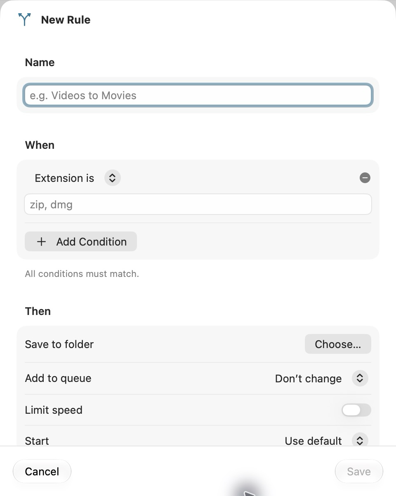
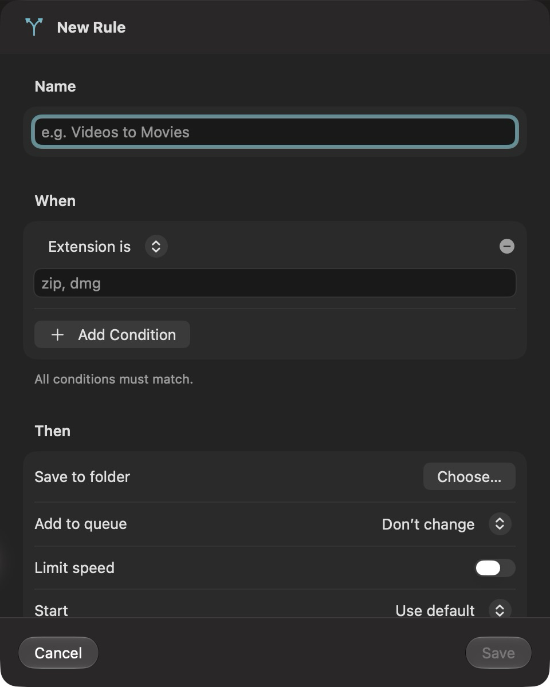
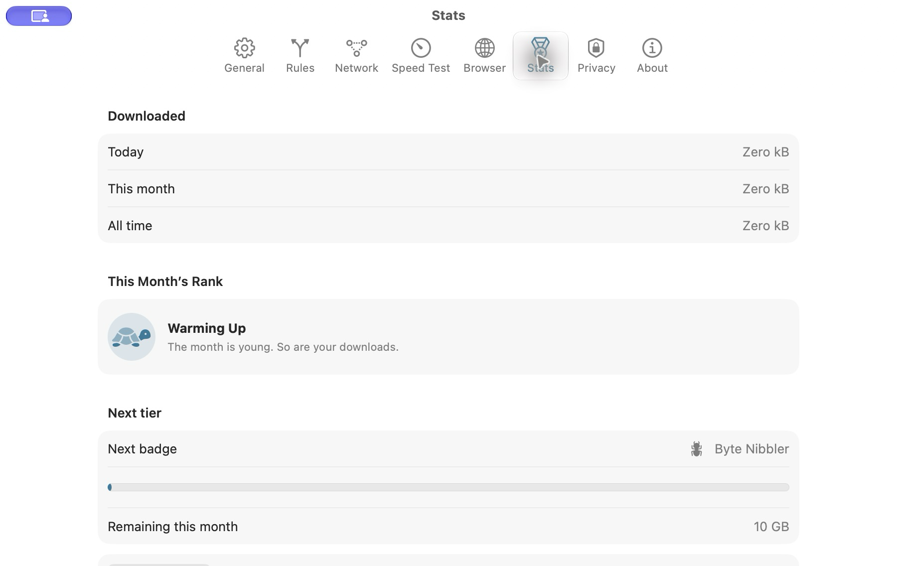
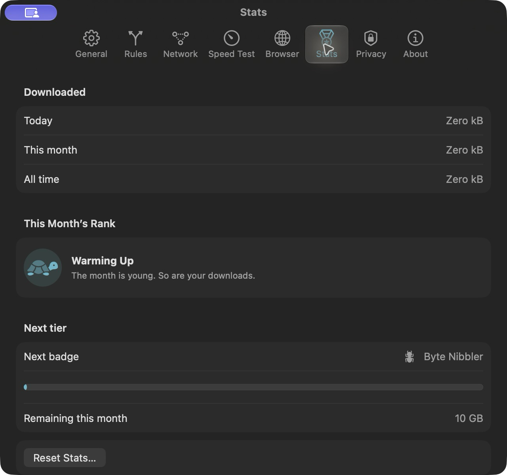
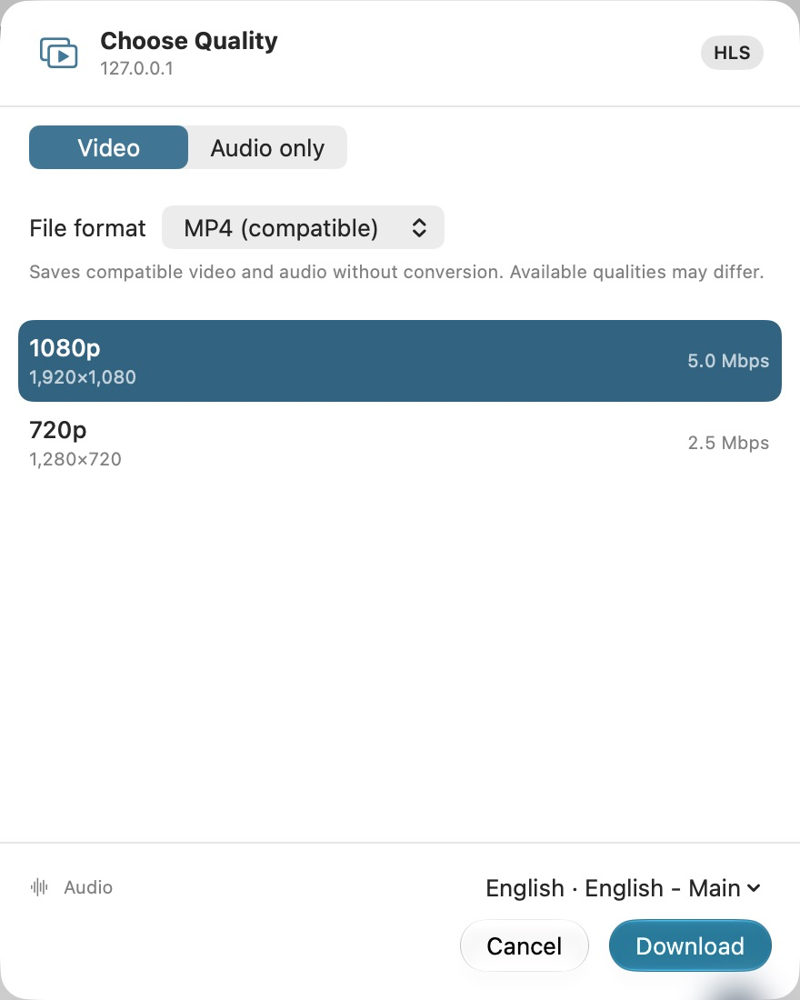
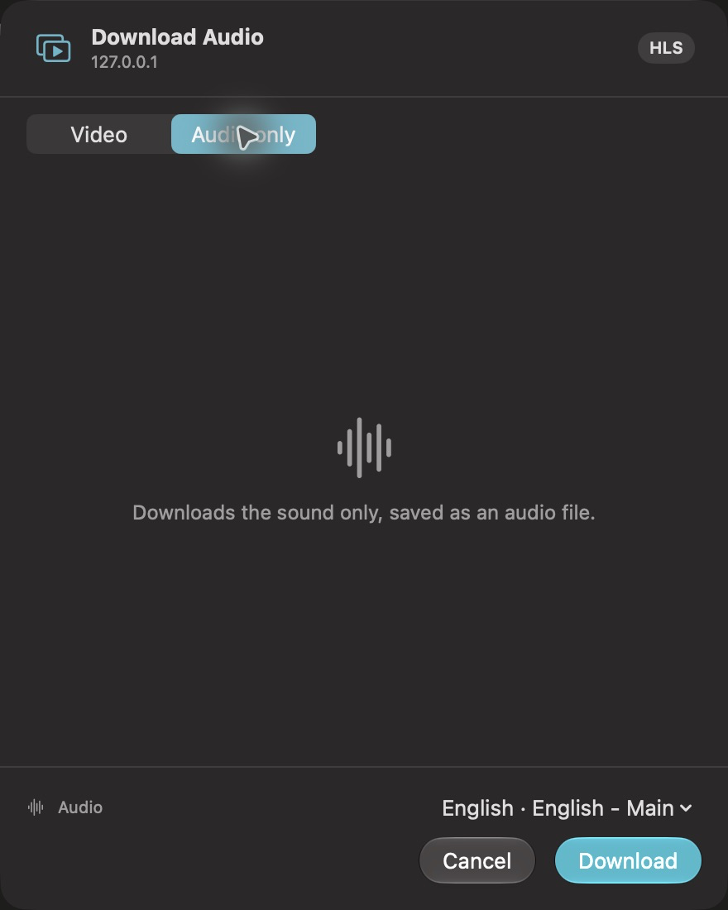

# Native layout refinements — November 17, 2026

Implements the five follow-up recommendations from the native design review, starting
from `f832227`. The [earlier screen inventory](2026-11-17-full-width-url-and-screens.md)
and [dependency audit](2026-11-17-dependencies-and-controls.md) remain separately dated.
This pass changes presentation only; it does not change the engine, dependencies or website.

## Changes

1. **Rule editor:** rule names and condition values occupy full rows. Condition type and
   removal sit above the value, with examples inside the text field. Category and numeric
   conditions retain native controls and accessible names. The numeric field has a visible
   MB unit, and the grouped form scrolls above fixed Save/Cancel actions.
2. **Grab Links:** the paste editor is the primary input and receives initial keyboard focus.
   Page fetching is a separate disclosure. The body scrolls while the header and actions stay
   fixed; the editor and results list have bounded heights. This fixes the overflow found
   during verification when Fetch Links was expanded alongside populated results. Existing
   pattern expansion, fetching, filtering, selection and destination logic are unchanged.
3. **Inspector:** source, destination and other file details now follow the transfer overview.
   Segment progress lives in a native disclosure after the details/media sections. Selecting
   another download starts it collapsed; per-segment progress and accessibility grouping are
   preserved. The inspector itself remains permanently available and resizable.
4. **Sheet and Settings sizing:** New Download, Grab Links, Rules and Media use shared
   minimum/ideal dimensions with flexible maximums and native fitted presentation sizing.
   Repair and Playlist also replace fixed widths with minimum/ideal widths; playlist results
   can expand vertically. Settings keeps a 640 × 600 pt default with a 640 × 480 pt minimum.
   The full-width New Download URL from the prior pass is preserved.
5. **Stats:** Today, This month and All time lead the page. The monthly rank uses a compact
   badge beside its text, followed by progress to the next tier. Totals use tabular digits.
   Reset confirmation and local-only storage behavior are unchanged.

The new “Paste links” label is translated in all ten supported non-English languages.
Existing native controls, SF Symbols and glass action footers remain in place. No glass
was added to form groups, list rows or scrolling content.

Apple documents [fitted presentation sizing](https://developer.apple.com/documentation/swiftui/presentationsizing/fitted)
as resizable by default on macOS, with minimum/ideal/maximum frames controlling its bounds.
This replaces the fixed frames that previously prevented expansion. Interactive edge resizing
could not be reliably exercised by this automation session; that interaction is **not certified**
by the screenshots below.

## Verification

- Regenerated the ignored Xcode project after extracting `InspectorSegmentsView`.
- Final arm64 Debug build: `GIT_CONFIG_COUNT=0 xcodebuild -project CloakDrop.xcodeproj
  -scheme CloakDrop -destination 'platform=macOS,arch=arm64' -configuration Debug
  -derivedDataPath build/Verify build` — exit **0**, **BUILD SUCCEEDED**, no warning/error matches.
- `swiftlint --strict` — **0 violations in 194 files**.
- `python3 scripts/validate_localizations.py` — **538 strings × 10 languages**, all translated
  and placeholders consistent.
- `codesign --verify --deep --strict build/Verify/Build/Products/Debug/CloakDrop.app` and
  `git diff --check` — both exit **0**.
- Restarted the current built binary for native checks on macOS **27.2.1**, Xcode **27.2**.
  Debug fixture launches use an in-memory example catalog and optional forced dark appearance.
- **Rules, light/dark:** full-width name/string input, initial focus, disabled/enabled Save,
  category and numeric condition controls, accessible labels and cancellation inspected.
  No rule was saved.
- **Grab Links, light/dark:** initial editor focus, empty/disabled Add, pasted results, numbered
  pattern expansion, filter/clear, page-source disclosure, selection count and cancellation
  checked. A loopback page supplied two links alongside three pasted links. Scrolling reaches
  import/destination controls while the header/footer remain visible. No Add action submitted.
- **Inspector, light/dark:** source/destination appear before segments. Expanding the disclosure
  reveals eight segment rows; changing selection and returning resets it to collapsed. Main
  window also checked at **865 × 573 pt**, then restored to **1097 × 679 pt**.
- **Stats, light/dark:** totals-first hierarchy, compact badge and next-tier progress inspected;
  final Settings default observed at **640 × 600 pt**. Reset was not invoked.
- **Media, light/dark:** a loopback HLS master with two video variants opened the native picker.
  Video and audio-only modes had usable actions; two English tracks were distinguishable as
  Main and Commentary. The picker was cancelled without submitting Download.
- **Other sheets:** New Download local-manifest preview and quality handoff checked;
  Repair's empty input/disabled action inspected in dark; Playlist's initial input, quality,
  format and disabled actions inspected in normal appearance and cancelled without reading.
- Stopped the loopback fixture server. Restored normal appearance, original main window size
  and Failed sidebar selection. The original four completed records remain. No user catalog,
  preferences, browser data or lifetime counters were cleared, and no transfer was created.

## Evidence

| Rules, light | Rules, dark |
| --- | --- |
|  |  |

| Stats, light (expanded window) | Stats, dark (default window) |
| --- | --- |
|  |  |

[Grab Links with parsed results](evidence/2026-11-17-layout-refinements/batch-dark.png) and
[compact inspector](evidence/2026-11-17-layout-refinements/inspector-compact-dark.png) show
the revised content hierarchy. The batch capture stops above the personal destination;
the inspector uses only the example catalog.

| Video picker, light | Audio-only picker, dark |
| --- | --- |
|  |  |

Sharing and pointer overlays belong to the verification tool. Captures are PNG conversions of
native screenshots; they do not alter the displayed UI. Fixture statistics are illustrative.

This pass does not certify interactive sheet edge resizing, spoken VoiceOver, every localization,
macOS 26 rendering, every conditional media/playlist/repair state, external media services,
Release signing/notarization or Share Extension handoff. Core tests were not rerun for these
presentation-only changes; the earlier dependency audit records its own 673-test result.
No release, push or deployment was performed.
