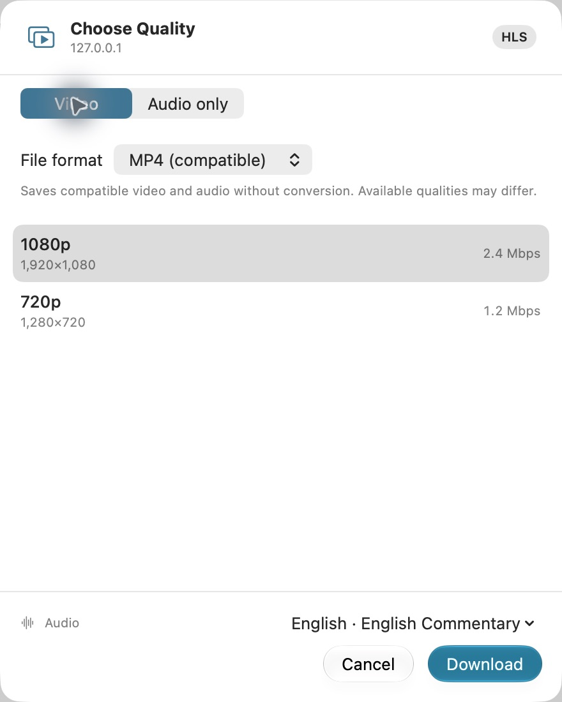
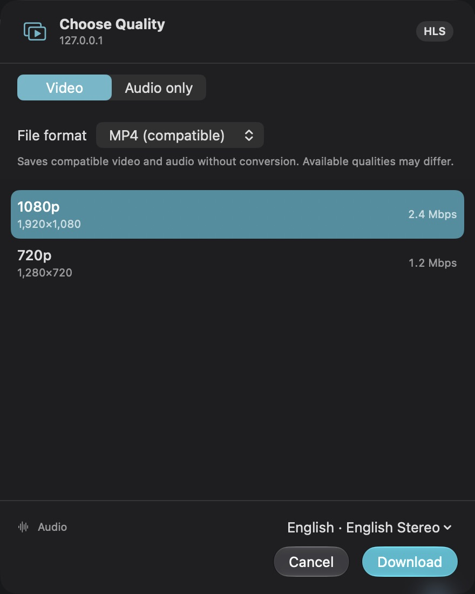
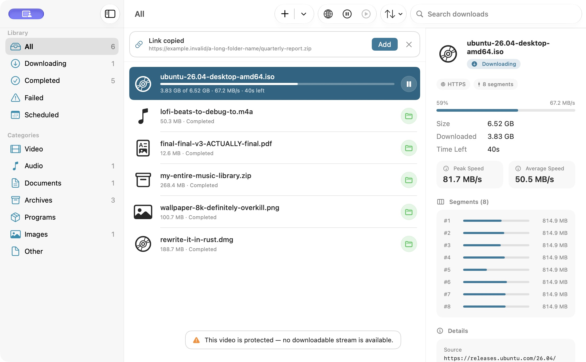
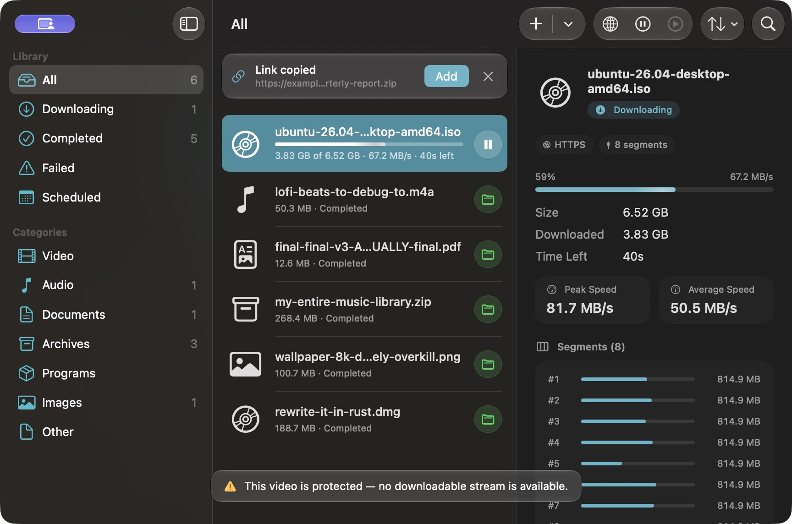
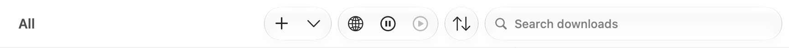

# Native materials verification — November 17, 2026

The custom CloakDrop surfaces identified in the
[family native audit](https://github.com/cloakyard/cloakyard/blob/main/docs/native/LIQUID-GLASS-AUDIT-2026-11-17.md)
now use modern native materials. This is a bounded SwiftUI presentation change,
verified against baseline `4ff6b4627adf7d5b21e52f47f833780e61a6cb77` on macOS 27.2.1,
Apple silicon and Xcode 27. It does not publish a native release or certify the
entire earlier audit's remaining state matrix.

## Changes

- Removed the extra regular-material band from the shared sheet heading. Titles
  can wrap; the sheet supplies the readable background.
- Centralized large glass capsule actions across New Download, Grab Links,
  Repair Download, Import Playlist, Choose Quality/Download Audio, Rule Editor
  and browser authentication. Primary actions use `glassProminent`; secondary
  actions use `glass`. Existing roles, shortcuts and validation remain intact.
- Replaced the clipboard banner and status toast's regular material with regular
  Liquid Glass. The toast uses a rounded rectangle and permits wrapped text.
- Added opaque semantic surfaces and native bordered actions for Reduce
  Transparency and increased contrast, and reduced-motion-aware transitions.
- Left native toolbar/menu/popover presentation and ordinary content surfaces
  intact, following Apple's [materials guidance](https://developer.apple.com/design/human-interface-guidelines/materials).

## Rendered coverage

L/D means the named state was visually inspected in both appearances. These are
state-specific observations, not an assertion that every branch passed.

| Surface | Observed result | Remaining coverage |
| --- | --- | --- |
| New Download, 520 × 600 pt | L/D empty form, disabled primary, focused URL, Escape cancel | Long localized fields, all inline errors |
| Grab Links, 580 × 600 pt | L/D three expanded sample URLs, readable instructions, enabled primary, Escape cancel | Large result sets and page-fetch errors |
| Import Playlist | L/D initial form, quality/format pickers, disabled primary, Escape cancel | Loading, populated playlist and extraction failures |
| Rule Editor, 480 × 540 pt | L/D empty rule, disabled Save, scrollable form, Escape cancel | All condition combinations and localized labels |
| Media picker, 440 × 550 pt | L/D local HLS video and Audio only mode, enabled Download, Escape cancel; distinct English Stereo/Commentary choices | Standalone audio-page picker, subtitle combinations and all output formats |
| Repair Download, 480 pt wide | L/D sample record, initial disabled and valid-URL enabled primary, Escape cancel | In-flight repair, restart-required and inline error variants |
| Browser authentication | Shared heading/actions and credential behavior reviewed in source | Loopback HTTP 401 did not open the sheet; visual check remains open; no credentials entered |
| Clipboard banner | L/D long URL with truncation; Add prefills the sheet and clears the suggestion; empty Failed list also checked in dark | Independent Dismiss interaction and all localization lengths |
| Status toast | L/D extraction-error fixture with populated and empty content; visible at compact size | Loading/moving labels and extremely long localized errors |
| Accessibility fallbacks | New Download in dark with Reduce Transparency and Increase Contrast separately; banner/toast in light with each preference separately | Full L/D matrix, spoken VoiceOver and live Reduce Motion timing |

The main window was checked at 1097 × 679 pt and a compact 864 × 572 pt using
macOS window arrangements. The clipboard buttons and toast remain visible at
the compact size; the URL truncates within its available space. Native phone and
tablet viewports do not apply. Larger text and all supported languages were not
visually exercised.

## Evidence

These unedited captures contain only local media or in-memory sample data. The
computer-use pointer/sharing indicators may be visible; these are audit evidence,
not marketing assets. Other captures remain local because they include existing
download names or the user's home path.

| Light | Dark |
| --- | --- |
|  |  |
|  |  |

## Checks and cleanup

- XcodeGen regeneration and arm64 Debug build: passed, warnings treated as errors.
- Strict SwiftLint: passed. Localization validation: 537 strings × 10 languages,
  all translations and placeholders consistent.
- Both CloakDrop READMEs pass the family structure/link validator (36 local
  references); 57 references in the affected documentation resolve. The wider
  family run reports an unrelated in-progress CloakPDF README format failure;
  no CloakPDF working-tree files were changed by this task.
- `git diff --check`: passed. The new shared styles have live consumers; no
  `.regularMaterial` remains in `App/`. No dependency, engine, persistence or
  transfer-policy change was introduced. Core tests were not rerun for this
  presentation-only change.
- The existing in-memory hero fixture gained opt-in chrome, resolving and repair
  states, documented in the [verification guide](../../.agents/skills/verify/SKILL.md).
  To use the permitted app launcher without command-line arguments, a temporary
  build selected the chrome/repair fixture by default. Those launch-default edits
  were restored before the final normal build; normal launch was verified against
  the original four-record catalog with no fixture UI.
- Local HLS verification used `127.0.0.1:4388`. A single-variant audio manifest
  took the existing file fallback path and saved 91 bytes instead of opening a
  picker. Its record was removed and the generated file moved out of Downloads
  into temporary verification storage. Lifetime counters may retain that test's
  91 bytes/one completion; user statistics were not reset. Video and Audio only
  mode checks were cancelled before downloading media.
- System appearance returned to Auto, accessibility toggles to off, System
  Settings to Keyboard, and the app to its normal All view and previous window
  arrangement. The loopback fixture server was stopped.

Ad-hoc Debug verification does not validate Release Share Extension/App Group
handoff, Developer ID signing, notarization, macOS 26 rendering or native
distribution. The source changes are separate from the previously deployed
websites.

## Toolbar spacing follow-up

The Add primary-action menu packed the plus, divider and chevron into a narrow
split control. The follow-up replaces it with a native Add button and a native
Download options menu in the same toolbar group. Both use system toolbar sizing.
Fixed `ToolbarSpacer` items separate Add/options, Browser/transport and Sort.
Sort uses its existing up/down symbol without a second cramped chevron. The
toolbar keeps system glass, focus, disabled states and overflow behavior; no
custom button drawing or hard-coded control widths were added. This follows
Apple's [toolbar grouping API](https://developer.apple.com/documentation/swiftui/toolbarspacer).

The new Download options label/help is translated in all ten supported languages.
The obsolete combined split-button help entry was removed, keeping the string
catalog at 537 keys. No download or persistence behavior changed.

| Check | Result |
| --- | --- |
| Normal window, about 1097 × 679 pt | Light/dark: consistent button spacing, distinct Add/options controls and clear group boundaries |
| Compact window, about 864 × 572 pt | Light/dark: all toolbar controls visible with search collapsed; no clipped icons |
| Expanded compact search | Light/dark: readable focus ring/query and no-results state; secondary commands move to native overflow |
| Overflow | Disabled Resume All remains disabled; Sort and its choices are accessible; Name selection works |
| Add and options | Plus opens New Download; dropdown presents Add Download/Grab Links/Import Playlist; keyboard Down/Return opens Add; Grab Links opens correctly |
| Keyboard/navigation | ⌘N opens New Download; Escape cancels sheets/menus; Browser opens its blank start page and closes normally |
| Sort/search cleanup | Name and Date Added selection exercised; original Date Added restored; search cleared |
| Build and static checks | Warning-free arm64 Debug build, strict SwiftLint, all localizations and `git diff --check` pass |

Verification used the existing `--hero-fixture` and `--verify-dark-appearance`
launch arguments. No live transfer was started or personal history modified.
Pause/Resume operation logic was not rerun; the fixture verifies their enabled
and disabled presentation. Import Playlist is disabled in this fixture because
the extractor capability is unavailable. Spoken VoiceOver, macOS 26 rendering
and every localized toolbar were not rechecked. The original window size and
system-driven appearance were restored; the updated sample preview remains open.

The following are toolbar-only crops of native screenshots, with no redrawing:

